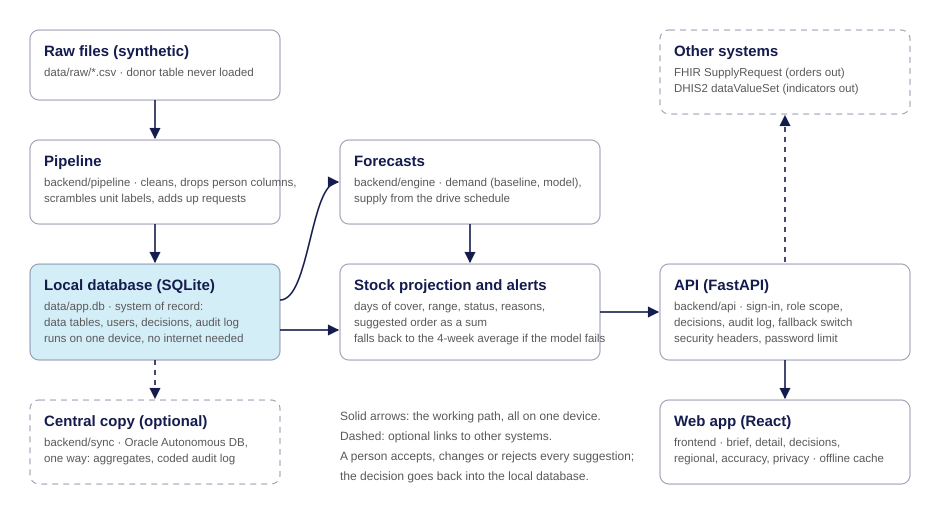

# MediBora: Sanguis Providus warns a blood service which blood groups will run short, where, and in how many days

Terumo BCT Africa Hackathon 2026 · Challenge area: forecasting and stock-out early warning

> All data is the organisers' synthetic starter dataset. Nothing here describes a real hospital, donor or patient.

## The problem
A hospital blood bank officer finds out a blood group has run out when a request cannot be filled. The fix is
then an emergency call to the regional centre. In the starter dataset (numbers from `docs/DATA_FACTS.md`,
computed by our pipeline):

- 12.9% of requests were not fully met, and 43.8% of O negative units requested were never issued.
- An emergency resupply took a median of 5.2 hours.
- 23.2% of red cell and whole blood units were wasted, while other shelves were empty.
- Collections were 37.4% lower in school breaks than in term time.

Our users are the **hospital blood bank officer**, who needs to know each morning which groups will run short
before the next delivery, and the **regional centre officer**, who needs the same view across every hospital
they supply.

## What we built
- What works now:
  - One command builds a local database from the raw files and writes the data facts.
  - A baseline forecast (same weekday, last 4 weeks) with a backtest over 16 weekly dates.
  - A 14-day stock projection per hospital, product and blood group, with days of cover, a range,
    a status (Act, Watch, Steady), plain-language reasons and a suggested order shown as a sum.
  - A supply forecast for red cells: cleared units per regional centre from the drive schedule, what each
    hospital will receive, and regional centre stock, each compared with a simple baseline.
  - An alert check against what really happened, compared with a simple cover rule (`docs/RESULTS.md`).
  - An API with three test log-ins, role-based access, Accept / Change / Reject, and an append-only audit log.
  - A landing page that tells the story in three beats with a blood bag that fills as you scroll (drawn in
    SVG, no 3D engine). It is loaded only when signed out, becomes plain stacked sections on a phone, and
    stays still if the device asks for reduced motion.
  - Sign-in with three one-tap test accounts and the morning brief: one plain sentence, then the eight
    blood groups with days of cover, a cover bar and a status. It keeps the last brief in the browser and
    shows it with a banner if the server cannot be reached. It works at 360, 768 and 1280 pixels wide.
  - A detail view per blood group: the 14-day projection with its range, delivery markers and the point where
    stock runs out, the reasons, compatible stock (information only), and the suggestion with its sum.
    Accept, Change or Reject; Change and Reject need a reason. A 10-second undo. A Decisions page lists the log.
    A switch shows what really happened next, which the forecast never sees.
  - A pooled forecast model (gradient boosting, trained across all hospitals) compared with the baseline on the
    same test dates, and an Accuracy page that shows both sets of numbers, a table by kind of hospital and the
    fallback switch.
  - A regional view for the regional centre officer: every hospital and blood group in one grid, the supply
    outlook for 4 weeks, the gap against demand by blood group, suggestions for extra collections (each with
    Accept, Change or Reject), and a "what if we add a drive" try-out that saves nothing.
  - Standards: an accepted order as a FHIR R4-shaped SupplyRequest ("View as FHIR"), a DHIS2-shaped monthly
    export, and a mapping table in `docs/STANDARDS.md`.
  - A Data & privacy page: what is used and never loaded, pseudonymising, who can see what (read from the
    settings the server enforces), where data is stored, cookies, what to do if something leaks, a data-flow
    diagram, and a privacy notice in English and Swahili.
  - Offline proof: a "Simulate offline" switch that blocks server calls and shows the cached brief with a banner.
  - **Fair-share allocation.** On 61% of the days a hospital ran short of a blood group, other hospitals in
    its region held spare units of it. The regional view proposes how to share each week's units by days of
    cover, and a replay of the test period compares that with what really happened (see AI and data).
  - If the forecast model is missing or fails, the API serves the baseline and says so in every response.
- What is mocked or not finished:
  - The central database sync is written and tested up to the connection, but has **not been run against a
    real Oracle database**. Until it is, the Data & privacy page shows "never" for the last sync.
  - There is no deployment. The app runs on one computer.
  - Security is a self-review (`docs/SECURITY.md`), not an independent test.
  - The FHIR order is FHIR-shaped: field names were checked against the HL7 R4 page, but it has not been run
    through a validator, and product codes are local stand-ins for ISBT 128 codes.
  - The DHIS2 export uses made-up element and organisation unit IDs (an illustrative mapping).
  - The SMS preview is labelled "Demo, not sent". No message is sent.
  - The Swahili privacy notice has not yet been checked by a fluent speaker on the team.
  - Drive suggestions are requests to a drive planner. Nothing is booked and no donor is contacted.
  - Units exposed to a warm fridge cannot be dated from the data, so they are not removed from projected stock.
  - School terms, public holidays and malaria months are approximate settings in `config/calendar_ke.yaml`.

Demo video (3 minutes or less): to come (script in `docs/DEMO_SCRIPT.md`)
Live demo: none (not deployed) · Test log-ins (demo only): `amina` / `thika-demo`, `joseph` / `maternity-demo`,
`grace` / `nairobi-demo`

## How to run it
You need Python 3.11 or newer and Node.js 20 or newer.

**1. Get the code and set up Python** (run from the repo folder)

Windows (Git Bash):
```bash
python -m venv .venv
source .venv/Scripts/activate
pip install -r requirements.txt
```

Windows (PowerShell):
```powershell
python -m venv .venv
.venv\Scripts\Activate.ps1
pip install -r requirements.txt
```

Linux or macOS:
```bash
python3 -m venv .venv
source .venv/bin/activate
pip install -r requirements.txt
```

**2. Build the database from the raw files** (1 to 3 minutes: it also trains and tests the forecasts)
```bash
python -m backend.pipeline.build
```

**3. Run the tests**
```bash
python -m pytest
```

**4. See the morning list for one hospital**
```bash
python -m backend.engine.brief --facility HSP-006 --as-of 2026-10-05
```

**5. Start the app** (backend on port 8000, frontend on port 5173; the first run installs the frontend packages)
```bash
python scripts/dev.py
```
Open http://localhost:5173 and choose one of the three test accounts. Stop with Ctrl+C.

**Optional: central database sync** (does nothing, and says so, unless the Oracle settings are in `.env`)
```bash
python -m backend.sync.oracle
```

If `pip install` stops with "Read timed out" on a slow connection, run
`pip install --default-timeout=120 --retries 10 -r requirements.txt`.

## Architecture


- **Data flow:** raw files → pipeline (cleans, drops person-level columns) → local SQLite database → forecasts
  (demand and supply) → stock projection, alerts and suggested orders → API → web app. A person's decision goes
  back into the local database and its append-only audit log.
- **Local first:** everything on the solid arrows runs on one device with no internet. The central copy is
  optional and one way.
- **Where it can fail, and what happens:** if the forecast model is missing or errors, the 4-week average is
  used and every screen says so. If the supply forecast fails, usual delivery quantities are used. If the server
  cannot be reached, the browser shows the last brief with a banner. If the central copy is not set up, the sync
  command says so and exits.
- **Where this sits in a blood-bank information system:** it reads counts (stock, requests, deliveries, drives)
  and hands back approved orders. It does not register donors, label units or record transfusions.
- **Standards:** an accepted order is served as a FHIR R4-shaped `SupplyRequest`; monthly indicators as a
  DHIS2-shaped `dataValueSet`; the dataset's unit label stands in for an ISBT 128 donation number. The mapping
  and its limits are in `docs/STANDARDS.md`.

Repo layout: `backend/pipeline` (data), `backend/engine` (forecasts, projection, alerts, regional view),
`backend/api` (server), `backend/sync` (central copy), `frontend` (web app), `config` (settings), `tests`, `docs`.

## AI and data
All numbers below are computed by `python -m backend.pipeline.build` and written to `docs/RESULTS.md`.
Test period: 16 Mondays from 6 July to 19 October 2026. On each date the forecasts see only earlier days.

- What the AI or data feature does: forecasts demand per hospital, product and blood group for 14 days;
  forecasts red cell supply per regional centre for 4 weeks from the drive schedule; projects each shelf
  forward and warns before a shortage.
- Baseline we compared against: the average of the same weekday over the last 4 weeks (demand); the average
  of the last 4 weeks (supply); "cover under 3 days on the 28-day average" (alerts).
- Result:
  - Supply (cleared red cell units per centre and week): baseline 58% error vs ours 26%.
  - Demand (7-day totals): baseline 71.3% error vs ours 67.9%. A small gain: demand is nearly flat all year.
  - Early warning: the simple rule warned before 65% of real shortages, ours before 76%, with about the same
    share of false alarms (27% and 28% of warnings were followed by a real shortage).
  - Fair-share allocation (replay, 6 July to 31 October 2026, same blood and same requests): red cell units a
    hospital's own shelf could not supply fell from 2,078 to 1,410 (32% fewer), and units expired on hospital
    shelves from 1,415 to 1,256. The replay's own baseline (20.8% not from the shelf) is close to the real
    records (20.2%). The best-stocked hospitals lose cover, including the national referral hospital.
- How a user sees the reason for a recommendation: two or three short sentences beside each alert, built by
  templates from computed numbers, and the suggested quantity shown as a sum of its parts.
- Who approves it (Accept / Change / Reject): the signed-in officer. Change and Reject need a reason.
  Every decision is written to an append-only audit log with what the person was shown.
- What happens if the AI is wrong or offline: a switch on the Accuracy page, or any failure of the model,
  makes every screen use the 4-week average and say so. The last brief is kept in the browser for offline use.

## Data
The organisers' synthetic starter dataset, in `data/raw/`. Tables used: facilities, routes, drives, donations,
units, transfers, requests, daily_stock, power_outages, temperature_logs.
The donor table is deliberately not in this repo and is never loaded. No real donor, patient or facility data.

## African conditions
- **Power and connectivity:** the tool runs on one laptop with a local database and no internet. The browser
  keeps the last brief and shows it with a banner when the server cannot be reached ("Simulate offline" shows
  this). The working screens have no animation and the whole app is about 140 KB of script, for slow links.
- **Phones:** every screen works at 360 pixels wide, with a bottom navigation bar and 44-pixel touch targets.
  An SMS preview shows the day's alerts in 160 characters (demo only; nothing is sent).
- **Languages:** every sentence a user reads is in one file (`frontend/src/i18n/en.ts`), so a language can be
  added without touching screens. The privacy notice is in English and Swahili (Swahili not yet checked).
- **Another site or country:** school terms, public holidays and malaria months are in
  `config/calendar_ke.yaml`; alert thresholds and minimum stock in `config/thresholds.yaml`; shelf lives and
  blood groups in `config/blood.yaml`; roles in `config/access.yaml`. Change settings, not code.
- **Existing systems:** FHIR and DHIS2 shaped outputs (see Architecture).
- **Rules that reflect how blood moves here:** any early delivery or extra collection is a request for
  approval, never an order. Compatible stock is shown as information only.

## AI tools we used
| Tool | What we used it for |
| --- | --- |
| Claude Code (Anthropic) | Writing and testing the code in this repo during the hackathon, under the team's direction: the data pipeline, forecasts, API, web app, tests and documentation drafts. It also checked the screens with screenshots. |
| Design skill packs for Claude Code: impeccable (pbakaus), taste-skill (Leonxlnx), skills (emilkowalski) | Checklists read during one design polish pass: contrast, touch behaviour, interaction states, motion timing. They are instruction documents, not code; none of their scripts were run and none of their files are in this repo. |

The team set the plan and the rules (`docs/BUILD_PLAN.md`, `CLAUDE.md`), chose the problem and the design
direction, checked the data findings, ran and reviewed each step, and can explain the code. No language model
runs inside the product: forecasts are statistical models and the reasons are written by templates.

## Team
| Name | Role | Country | Presenting Friday (in person / online) |
|------|------|---------|-----------------------------------------|
| Linet Mugwanja | to confirm | Kenya | to confirm |
| Eugene Mutembei | to confirm | Kenya | to confirm |
| Jael Wainaina | to confirm | Kenya | to confirm |
| Washington Adiado | to confirm | Kenya | to confirm |
| Trixy Wangui Wainaina | to confirm | Kenya | to confirm |

Data lead: to confirm (one named person from the table above).

## Known limits and next steps
- **Accuracy:** most warnings are still false alarms (about 28% are followed by a real shortage), and the
  median warning comes 1 to 2 days ahead. The demand model beats the 4-week average only slightly.
- **Fair share is a replay, not a trial.** It assumes units can be re-split within a delivery day, ignores
  vehicle capacity, and has no protected minimum for referral hospitals. It is a proposal a person approves.
- **Synthetic data:** every number describes the model dataset, not real hospitals. The approach needs testing
  on real stock and request records.
- **Hospital deliveries** are only slightly better predicted than by their 4-week average; some hospitals in
  the data live almost entirely on emergency deliveries.
- **Units exposed to a warm fridge** cannot be dated from the data, so they are not removed from projected stock.
- **Calendar:** school terms, public holidays and malaria months are approximate settings to confirm.
- **Platelets** are not held at hospitals in this dataset, so they have a demand forecast but no shelf projection.
- **Privacy and compliance, before real use:** a data protection impact assessment (DPIA), registration with the
  Office of the Data Protection Commissioner (ODPC), processor agreements with any hosting company, a decision
  on the hosting region, and small-count suppression outside the hospital.
- **Security, before real use:** remove the test log-ins, HTTPS, an independent penetration test, account
  management (see `docs/SECURITY.md`).
- **Standards:** ISBT 128 product codes, a FHIR validator run, and real DHIS2 element IDs.
- **Next:** test with a blood bank officer, add Swahili screens, send the approved SMS through a gateway, and
  model what each hospital will actually receive more closely.
